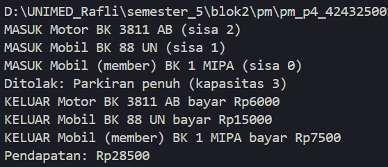
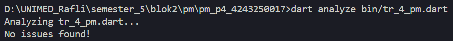

A. IDENTITAS
- Nama: Muhammad Rafli Wijaya
- NIM: 4243250017
- Kelas: PSIK 24D

B. DIAGRAM KELAS
- Diagram menggunakan mermaid diagram

C. TANGKAPAN LAYAR OUTPUT
- OUTPUT

- Dart Analyze

D. PENERAPAN ENKAPSULASI, POLIMORFISME DAN ASYNC
Pertama, enkapsulasi diterapkan pada kelas Parkiran. Field internal _kendaraanTerparkir (daftar kendaraan terparkir) dan _pendapatan (akumulasi kas) diberi awalan underscore _ jadi bersifat privat terhadap berkas (library-private). Akses dari luar dikontrol secara ketat melalui getter sisa dan pendapatan, sedangkan perubahan status data hanya dapat dilakukan melalui method terkendali masuk() dan keluar().

Kedua, polimorfisme diterapnkan melalui relasi pewarisan kelas abstrak kendaraan kepada subclass motor, mobil, truk, dan kelas MobilMember dengan mixin berlangganan. Pada fungsi main(), antrean kendaraan disimpan dalam satu koleksi seragam List<Kendaraan>. Saat method k.biaya() dan getter k.jenis dieksekusi secara dinamis saat runtime, Dart memanggil perilaku spesifik tiap kelas, termasuk diskon tarif 50% bagi member.

Ketiga, asynchronous programming diterapkan pada method masuk() dan keluar() menggunakan kata kunci async dan await. Simulasi jeda mekanis buka-tutup palang otomatis direpresentasikan melalui Future.delayed(). Selain itu, setiap peristiwa masuk atau keluar dipancarkan secara real-time tanpa memblokir thread utama menggunakan StreamController.broadcast(), yang kemudian ditangkap oleh listener monitor pos jaga.

E. PERNYATAAN PENGGUNAAN AI